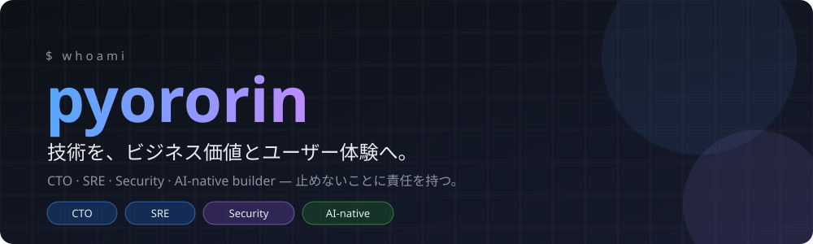
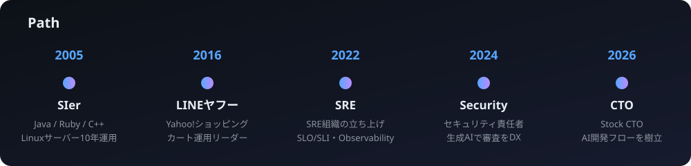
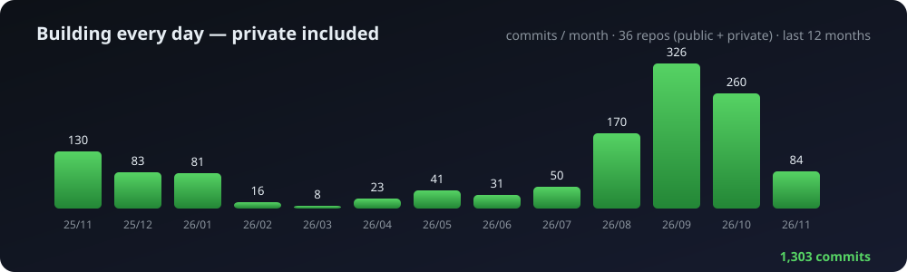

  

  
  
  
  

## ✦ 何をする人か

開発・インフラ・セキュリティ・組織まで、**「サービスを止めない」ことに一貫して責任を持つ**エンジニアです。
月間数億PVのECを守る側から、スタートアップのCTOへ。いまは、設計から検証環境・テストまでをAIが担う開発フローを回しています。

<table>
<tr>
<td width="33%" valign="top">

**🛡️ Security × AI** 
ガバナンスを担いながら、生成AIで審査・相談を半自動化。相談時間 **-30%**。

</td>
<td width="33%" valign="top">

**📈 SRE / Observability** 
SLO/SLI、エラーバジェット、機械学習による異常検知。**SRE組織を0から**立ち上げ。

</td>
<td width="33%" valign="top">

**⚡ 高負荷・大規模運用** 
大規模セールの入場制限(待機体験)の設計で **グッドデザイン賞 2021**。

</td>
</tr>
</table>

## ✦ 手を動かし続けています

> 作っているものの大半は **private** です。GitHub の草にはほとんど現れませんが、実際には毎月コミットしています。

| 公開しているもの | 中身 |
|---|---|
| [`prompt-ng-words`](https://github.com/pyororin/prompt-ng-words) | プロンプトインジェクション検出API(Spring Boot) |
| [`MagicalMirai-games001`](https://github.com/pyororin/MagicalMirai-games001) | マジカルミライ・プログラミング・コンテスト向けゲーム企画 |
| [`minesweeper-ts`](https://github.com/pyororin/minesweeper-ts) | AIコーディングエージェントで作ったマインスイーパー |
| [`jira-summary-chrome-extension`](https://github.com/pyororin/jira-summary-chrome-extension) | JIRA課題の要約表示Chrome拡張 |
| [`bakusoku-yamatan-chrome-extension`](https://github.com/pyororin/bakusoku-yamatan-chrome-extension) | 山小屋予約を“秒”にする非公式Chrome拡張 |

<b>🔒 private の工房(中身は非公開)</b>

 

| 領域 | 内容 |
|---|---|
| 🎬 動画制作 | GitHub Issues を起点に、台本・立ち絵・音声・サムネイルまでAIで自動生成するパイプライン |
| 📊 トレード | 板情報(OBI/OFI/CVD)を使ったスキャルピングBotと、検証・最適化の仕組み |
| 📐 Webツール | 図面PDF/画像をタップして実寸・面積を出す [Sumpo](https://sumpo.pyororin.net/)(運用中) |
| 🧪 実験 | 画像生成を使った着せ替えアプリ、データ分析、各種業務自動化 ほか |

## ✦ Tech

  
  
  
  
  
   
  
  
  
  

## ✦ もうひとつの仕事

2018年から、刑務所でIT未経験の受刑者向けに**職業訓練(ネット販売実務科)**の講師をしています。専門用語を使わずに伝える力は、ここで鍛えられました。

  

