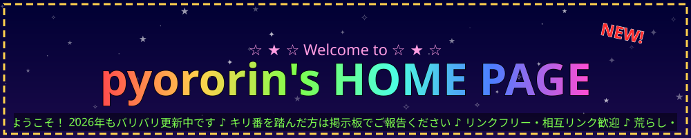

  
  <b>番目のお客様です！</b> 
  キリ番(100の倍数)を踏んだ方は、掲示板でご報告を…と言いたいところですが、掲示板は🚧工事中🚧です

  
  
  

Best viewed with: GitHub / 2026年版ブラウザ ・ 1024×768 以上推奨 ・ 最終更新 2026.11.01 ・ このサイトは <b>毎日更新中</b> です

<table>
<tr><td><b>ハンドルネーム</b></td><td>pyororin(ぴょろりん)</td></tr>
<tr><td><b>肩書き</b></td><td>エンジニア(開発・インフラ・セキュリティ・SRE)</td></tr>
<tr><td><b>モットー</b></td><td>技術を自己目的化せず、ビジネス価値とユーザー体験へ。<b>サービスを止めない</b>ことに責任を持つ。</td></tr>
<tr><td><b>お仕事のご相談</b></td><td><a href="https://findy-code.io/">Findy</a> / <a href="https://freelance.findy-code.io/">Findy Freelance</a> に登録しています(GitHub連携済み)</td></tr>
<tr><td><b>最近ハマっていること</b></td><td>設計からテスト・検証環境までをAIにやらせる開発フロー</td></tr>
<tr><td><b>すきなもの</b></td><td>登山 ⛰️ ・ 初音ミク 🎤 ・ AI 🤖 ・ FF14 ⚔️</td></tr>
</table>

- 🛡️ **セキュリティ × 生成AI** — 脆弱性・攻撃への対処と、生成AIを使った審査・相談業務の半自動化
- 📈 **SRE / Observability** — SLO/SLI、エラーバジェット、機械学習による異常検知、負荷試験・キャパシティプランニング
- ⚡ **高負荷・大規模サービスの運用** — 入場制限(待機体験)の設計で **グッドデザイン賞 2021**
- 🤖 **AI開発フロー** — 設計・実装・テスト・検証環境の用意までをAIが担う仕組みづくり
- 🧱 **フルスタック** — インフラ(Linux/クラウド)からアプリ(Java / Ruby / Go / TypeScript ほか)まで自分の手で

  
  
  
  
  
  
  
  

| 時期 | 触ってきたもの |
|---|---|
| **2000年代** | Java / Ruby / C++ での業務システム開発。Linuxサーバーの構築・運用 |
| **2010年代** | Webアプリ開発(Rails ほか)、大規模ECの運用、負荷対策 |
| **2020年代前半** | SRE・Observability(SLO/SLI、異常検知)、セキュリティガバナンス |
| **2025〜** | Go / TypeScript / Python を中心に、AIコーディングエージェントとの協働開発。生成AIの業務活用 |

| 作品 | ひとこと |
|---|---|
| [prompt-ng-words](https://github.com/pyororin/prompt-ng-words) | プロンプトインジェクション検出API(Spring Boot) |
| [MagicalMirai-games001](https://github.com/pyororin/MagicalMirai-games001) | マジカルミライ・プログラミング・コンテスト向けのゲーム企画 |
| [minesweeper-ts](https://github.com/pyororin/minesweeper-ts) | AIコーディングエージェントで作ったマインスイーパー |
| [jira-summary-chrome-extension](https://github.com/pyororin/jira-summary-chrome-extension) | JIRA課題の要約をタイプライター風に表示するChrome拡張 |
| [bakusoku-yamatan-chrome-extension](https://github.com/pyororin/bakusoku-yamatan-chrome-extension) | 山小屋予約を“秒”にする非公式Chrome拡張 |

<b>👀 こっそり覗く(中身は非公開です)</b>

 

- 🎬 GitHub Issues を起点に、台本・立ち絵・音声・サムネイルまでAIで作る**動画制作パイプライン**
- 📊 板情報(OBI/OFI/CVD)を使った**スキャルピングBot**と検証の仕組み
- 📐 図面PDF/画像をタップして実寸・面積を出す Webツール [Sumpo](https://sumpo.pyororin.net/)(運用中)
- 🧪 各種業務の自動化 など

private の貢献も、右上の草にちゃんと反映しています。**ほぼ毎日、何か作っています。**

- **2026.11.01** Findy Freelance に登録しました(GitHub連携済み)
- **2026.11.01** ホームページを全面リニューアル(2000年代風)。公開リポジトリのREADMEも一斉に更新
- **2026.08** 作品置き場にマジカルミライ向けゲーム企画を追加

  
  
  
  
  

© 2026 pyororin ・ 当サイトの文章・画像の無断転載はご遠慮ください ・ お問い合わせはメールで(✉ MAIL)。掲示板は工事中です

